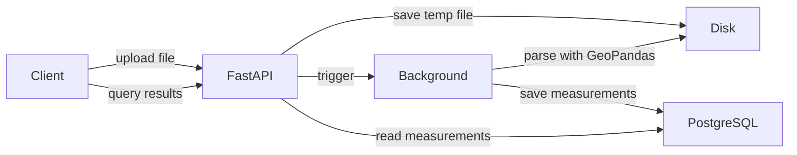

# Geospatial Measurement API

Upload a Shapefile (`.zip`) or KML and get the area (m²) of every polygon and the length (m) of every line, measured after reprojecting to a metric CRS, never in degrees. FastAPI + PostgreSQL backend with a small React frontend served by the same app.

Repo: <https://github.com/shivam-tamboli/geospatial-measurement-api>

## Architecture



## Live URL

<https://geospatial-measurement-api-zthu.onrender.com> (Swagger at `/docs`; `render.yaml` uses the free plan, so the first request after idle can be slow)

## Run locally

```bash
docker compose up --build        # app + Postgres + UI on http://localhost:8000
```

Without Docker (Python 3.12, Postgres running):

```bash
createdb geospatial && cp .env.example .env      # then set DATABASE_URL; all settings are env vars, see .env.example
python3.12 -m venv .venv && source .venv/bin/activate && pip install -r requirements-dev.txt
uvicorn app.main:app --reload                    # API on :8000
(cd frontend && npm ci && npm run build)         # optional: UI served by the API at /
(cd frontend && npm run dev)                     # optional: UI with hot reload on :5173
pytest                                           # 157 tests, SQLite, no Postgres needed
```

## API

| Method | Path | Notes |
|---|---|---|
| POST | `/api/files/` | Multipart field `file` (`.zip` Shapefile or `.kml`). Returns `202 {id, filename, status: "PENDING"}`; parsing runs in the background |
| GET | `/api/files/` | Uploads, newest first. `page`, `page_size` (default 20, max 100) |
| GET | `/api/files/{id}/` | `status` (`PENDING` → `PROCESSING` → `COMPLETED` / `FAILED`), `feature_count`, `crs`, `error`, `warnings` |
| GET | `/api/files/{id}/measurements/` | Per feature: WKT, WGS84 GeoJSON, properties, measurement. `page`, `page_size` (default 20, max 100; above that `400 PAGE_SIZE_TOO_LARGE`). `409` until `COMPLETED` |
| GET | `/health` | `{"status": "ok"}`, or `503 DB_UNAVAILABLE` |

Errors are always `{"detail", "code"}`. Trailing slashes are required. Full examples are in `/docs` and `postman_collection.json`; one, trimmed:

```bash
curl -F "file=@survey.kml" localhost:8000/api/files/                     # {"id":"8e4bcba8-…","filename":"survey.kml","status":"PENDING"}
curl "localhost:8000/api/files/8e4bcba8-…/measurements/?page_size=1"
```
```json
{"total": 3, "page": 1, "page_size": 1, "items": [{"feature_id": 0, "geometry_type": "Polygon", "crs": "EPSG:4326",
  "geometry_geojson": {"type": "Polygon", "coordinates": [[[77.0, 28.0], "…"]]},
  "measurement": {"type": "area", "value": 1090165.1617245723, "unit": "m²", "projected_crs": "EPSG:32643"}}]}
```

## Architecture

- **Structure:** `routes/files.py` (HTTP only) → `services/file_service.py` (orchestration, DB) → `file_parser.py`, `crs_handler.py`, `measurement.py` (geospatial, no DB or HTTP). `core/` holds config, logging, error classes, the upload-size guard and the frontend mount. `frontend/` is React + Vite + Tailwind + TanStack Query + Leaflet.
- **Upload:** reject on `Content-Length` before reading the body → validate name and magic bytes, stream to `uploads/<uuid>` → cheap structure check → insert `PENDING` row → `202`.
- **Processing:** `BackgroundTasks` runs `process_file` after the response. Parse in a worker thread (Fiona/GeoPandas, safe ZIP extraction), then measure and insert in batches of `PROCESSING_BATCH_SIZE` (50), all in one transaction committed with `COMPLETED`. Any error rolls back and sets `FAILED` with a safe message. On startup, anything still `PENDING`/`PROCESSING` is marked `FAILED`.
- **Measurement:** Polygon/MultiPolygon → area m²; LineString/MultiLineString → length m; Point/MultiPoint → null. Anything else, empty, unbuildable or unprojectable → null, logged, file continues. Unreadable KML folders, unparseable points and bad geometries become `warnings` (per-feature ones capped at 10).
- **CRS:** per feature, centroid → UTM zone (`floor((lon + 180) / 6) + 1`, EPSG 326xx/327xx; UPS beyond 84°N/80°S) → reproject → measure. Always reprojected, even if already projected (it may be in feet). Features are grouped by zone: one PROJ call per zone per batch. `crs` is `EPSG:<code>` only on an exact match, otherwise `CUSTOM:<WKT prefix>`. A Shapefile without `.prj` fails rather than guessing. UTM is conformal, not equal-area, so features spanning several zones are less accurate.
- **Data:** `uploaded_files` and `features` (properties and GeoJSON as JSONB). Measurements and GeoJSON are computed once at ingest and stored.

## Design decisions

- FastAPI over Django/DRF: async end to end and OpenAPI for free; no spatial queries, so GeoDjango/PostGIS isn't needed.
- `BackgroundTasks` over Celery/ARQ: no Redis or worker to run; the cost is the single-instance limit below.
- UTM per feature over one projection per file, equal-area or `pyproj.Geod`: metres, standard at survey scale, easy to label; the accuracy limit is documented.
- Compute at ingest and store (WKT + GeoJSON) over computing on read: reads are plain paginated queries, at the cost of two copies of each geometry.
- Batches of 50 in one transaction over one big pass: a 20k-polygon file peaked at 913 MB all at once vs 321 MB batched, and a file is never half-visible. Slower on data scattered over many zones; 500 recovers the speed.
- Cheap validation at upload, real parse in the background: obvious mistakes get a fast 4xx without holding a request on a big file.
- A partly readable KML completes with warnings over failing the file or skipping silently.
- `202 Accepted` over `201`: nothing is measured yet.
- SQLite for tests, Postgres in production: fast and hermetic, but blind to Postgres-only problems (CI against Postgres is future scope).
- Frontend served by FastAPI at `/` rather than deployed separately on Vercel — single origin eliminates CORS, one deployment pipeline, no split infrastructure for what is effectively an internal tool.
- File storage: Uploaded files are retained on local disk after processing (see Known Limitations); only extracted measurements are queried via the API. At production scale, files would be streamed directly to object storage (Cloudflare R2 or S3) before parsing, keeping server disk usage near zero and enabling horizontal scaling.

## Known limitations

- Processing is in-process, so the service must run as one instance with one Uvicorn worker. Several instances would fail each other's live jobs at startup, and several workers would need a real queue. A job in flight when the process dies is lost and shows up as `FAILED`.
- Uploaded files are never deleted. The ZIP or KML stays on disk after processing, even though everything useful is in Postgres, and `FAILED` uploads leave theirs behind too. On Render's free tier the filesystem is wiped on every redeploy, which hides the problem there. Anywhere with a persistent disk, usage grows with every upload.
- Features that span several UTM zones are measured less accurately, as described above. Nothing in the response says so.
- There is no authentication or rate limiting. Anyone who can reach the API can upload.
- The Content-Length guard can't see the size of chunked uploads. Those are streamed to disk until the limit is hit, then cleaned up. In production I would also set a body-size limit at the proxy.
- Parsing reads the whole file into memory (GeoPandas builds every geometry up front), so very large files still need a lot of RAM: a 17.6 MB zip of 20,000 polygons with 101 vertices each peaked at about 320 MB during parsing alone. Only the measuring step is batched, so it adds almost nothing on top of that instead of adding another 560 MB.
- Self-intersecting (bow-tie) polygons return an incorrect area. Shapely does not validate geometry before measuring, and the service does not reject such polygons. Real-world files rarely contain them, but when one does the number is wrong and the only signal is a log line: a 0.01° bow-tie measured 2.6 m² where its true area is about 540,000 m².
- Coordinates outside valid ranges (longitude beyond ±180°, latitude beyond ±90°) are accepted. They may produce a null measurement or GeoJSON with invalid coordinates, and nothing in the response says so. Validation at the geometry level is not implemented.
- Polygons that cross the antimeridian (±180° longitude) are not split in the GeoJSON output, so map libraries may render them incorrectly.
- `POST /api/files` without a trailing slash returns 405. The correct path is `POST /api/files/`.
- Schema changes need a manual database reset, because there are no migrations.
- A ZIP containing Shapefiles in different CRSs reports a comma-joined string in the file-level `crs`. Each feature still has its correct `crs`.
- KMZ and UTF-16 KML are not supported, and the Norway/Svalbard UTM zone exceptions are ignored.
- The map draws at most 5,000 features and says so when a file has more. The table is paginated server-side and has no such limit.
- Map tiles come from OpenStreetMap, so the map needs internet access.
- On Render's free tier the service idles out, and the free Postgres instance expires after a fixed period, so it is not suitable for anything you need to keep.

## Future scope

- Replace `BackgroundTasks` with ARQ and Redis: retries, a heartbeat per job instead of "fail everything at startup", progress reporting, and a webhook or server-sent event to replace polling.
- Delete the stored upload right after successful processing, and add a periodic job that removes the files of `FAILED` uploads after a configurable TTL, something like `FAILED_UPLOAD_TTL_HOURS`.
- Detect features whose bounds cross a UTM zone boundary and flag them in the response. For those, compute area and length with `pyproj.Geod` or a local equal-area projection.
- Add Alembic migrations in place of `create_all`.
- Run the test suite against Postgres in CI with Testcontainers, so column-length and JSONB problems are caught before deploy.
- Add Playwright tests for upload, polling and the map, and Vitest for the hooks.
- Add PostGIS, so I can answer bounding-box and intersects queries, and a GeoJSON export endpoint.
- Support KMZ and GeoPackage, and report invalid polygons as a field in the measurement instead of a log line.
- Move uploads to object storage, and add authentication with per-user file ownership.
- Serve very large files to the map as vector tiles or clustered points rather than raw GeoJSON.

## Learnings

- A green SQLite suite hid a `VARCHAR(255)` overflow on custom-CRS labels; review caught it, `TEXT` fixed it, real Postgres confirmed it.
- PROJ's default 70% match labelled a lookalike CRS as `EPSG:32643`; labels now need an exact match.
- Starlette spools the whole body before the handler runs, so the size check has to read `Content-Length` in middleware.
- GDAL 3.10 (the arm64 Docker image) can't open auto-named KML layers by name, and Shapely can't build a one-point LineString; both only showed up against the real image and adversarial files.
- Fiona has no Linux arm64 wheels and `python:3.12-slim` lacks `libexpat`, which broke the first Render deploy.
